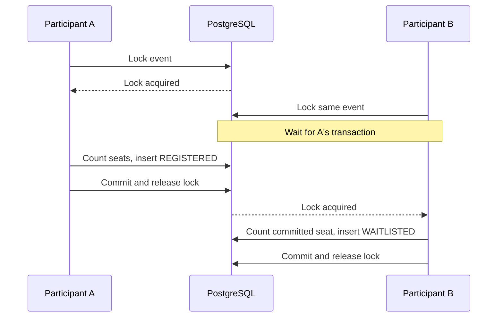

# Transactions and concurrent registration

## Why the last seat needs a lock

Suppose an event has capacity 1. Two requests can both count zero registered
participants before either inserts a row. A unique user/event constraint does not
prevent overselling: these are two different users, so both inserts would be valid.

We serialize decisions for the same event with PostgreSQL's row lock. The
registration service acquires `SELECT ... FOR UPDATE` on the event before reading
capacity or changing participation. The lock lasts until commit or rollback.

The same rule applies when a participant leaves. Cancel the registration and
promote the oldest waiting ticket before releasing the lock. Other joins cannot
take the vacancy between those two changes. Event cancellation locks the same
row, so a racing join either completes first or sees the cancelled event and fails.
Different events use different rows and can proceed independently.

## What belongs in one transaction

Session authentication happens first. The service then acquires the event lock,
checks the current event state and current time, reads registration/capacity,
changes membership, increments the event version, and records the user action.
FastAPI's function-scoped database dependency commits before sending a successful
response. On an exception it rolls back all of these changes and releases locks.
There is no intermediate committed empty seat during promotion.

The database's unique user/event constraint provides an additional guard against
duplicate rows. The service handles normal retries by returning the existing
active registration, rather than causing a uniqueness error or replacing its
ticket. Row locks protect the capacity and FIFO invariants; constraints alone do
not enforce those cross-row business rules. All future registration writers,
including workers and administrative tools, must follow the event-lock protocol.

Status and roster reads acquire a shared event lock while collecting counts and
positions. This lets other readers proceed while excluding participation writes.
The dashboard instead obtains each page's registrations and queue positions in a
single SQL statement snapshot; its separate total count can change concurrently.

## Testing real contention

Ordinary API tests use one outer test transaction with savepoints. That makes
cleanup easy, but uncommitted fixtures are invisible to a second connection, and
one shared connection cannot demonstrate competing transactions.

The concurrency tests therefore commit users, sessions, and an event into the
suite's temporary PostgreSQL schema. Each concurrent HTTP request gets its own
database session and connection. A thread barrier starts the requests together.
Assertions inspect committed rows afterwards, then cleanup removes only those
fixtures. Tests cover the last seat, duplicate joins, duplicate withdrawals,
waitlist withdrawal racing with promotion, and a new join racing with withdrawal.

This verifies transaction correctness at the MVP scale. It is not a throughput
benchmark or evidence that the service handles arbitrary load.

## Finalized rosters

Phase 4 takes the same event lock for finalization, confirmation, withdrawal,
replacement, reassignment, deadline extension, and cancellation. One transaction
updates assignments, registrations, team versions/targets, event version, and
before/after audit records. Owner mutation request IDs are recorded in the same
transaction so a lost-response retry cannot promote another person. Stale event
versions reject concurrent owner edits, and team versions reject confirmation of
previous teammates. A database unique constraint prevents duplicate event/user
assignments, while the existing partial index prevents two finalized runs.

Tests issue simultaneous same-run/different-run finalizations and same-ID/different-ID
vacancy replacements through separate HTTP sessions. Successful retries reuse the
committed result; competing intents receive 409 and must refresh. The original
proposal memberships remain unchanged by these operations.

The scheduled worker claims the same event row with `FOR UPDATE SKIP LOCKED`,
processes each event in a separate transaction, and saves its job result with the
proposal. A savepoint lets known processing failures roll back partial proposals
while preserving a safe retry result. Process crashes roll back the whole event
transaction. Private inbox notices share their producing transaction and use a
recipient/key uniqueness constraint, so retrying cannot duplicate delivery. See
[automation and notifications](../features/scheduled-grouping-and-notifications.md).
